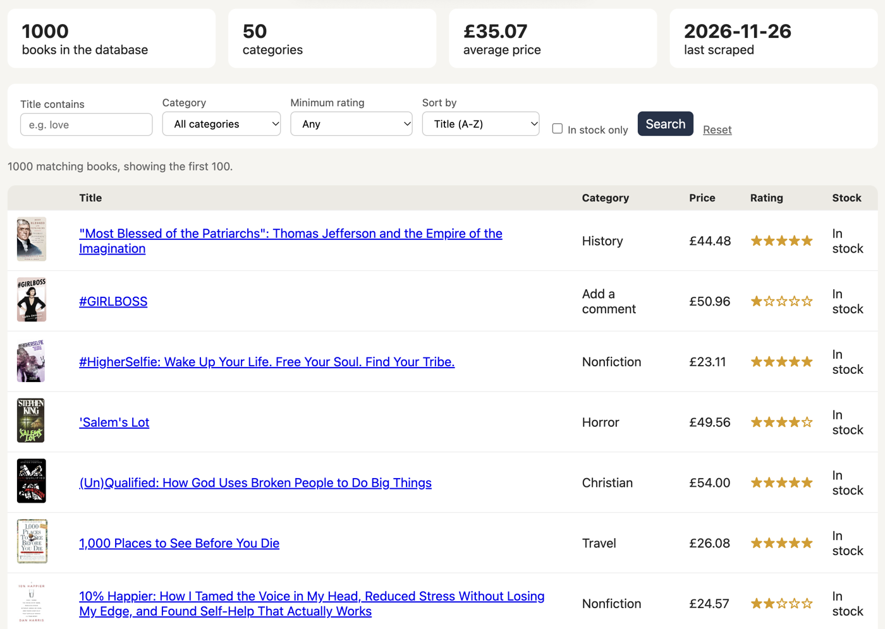

# Books to Scrape



## Purpose
Two small Python programs:
- `scraper.py` collects all 1,000 books from [books.toscrape.com](https://books.toscrape.com) and saves them in a SQLite database.
- `app.py` is a local website to browse that database: search by title, filter by category, minimum rating and stock, and sort by title, price or rating.

## Data collection
books.toscrape.com is a fake bookshop made for practising web scraping. The scraper:
1. Opens the home page and reads the 50 categories from the sidebar.
2. Visits each category page and reads every book card (`article.product_pod`): title, price, star rating, stock status, link and cover image.
3. Follows the **next** button until the category's last page.

It uses `requests` to download pages and `BeautifulSoup` to read the HTML. The rating is stored on the site as a word in a CSS class (`star-rating Three`), so the scraper converts it to a number (3). It waits 0.2 seconds between pages to be polite to the site. A full run takes about a minute.

## Data persistence
The books are stored in **`books.db`**, a SQLite database file created next to the scripts, in one table:

| Column | Example |
|---|---|
| `title` | A Light in the Attic |
| `category` | Poetry |
| `price_gbp` | 51.77 |
| `rating` | 3 (1 to 5) |
| `in_stock` | 1 (yes) or 0 (no) |
| `url` | link to the book's page (unique) |
| `image_url` | link to the cover |
| `scraped_at` | when it was last scraped (UTC) |

**Why SQLite:** it's a real SQL database, but it's just one file, comes built into Python and needs no account, server or password. Supabase, recommended in class, would need API keys, which are a risk in a public repository. The `url` column is unique, so running the scraper again updates the existing books instead of creating duplicates.

`books.db` is not committed to Git (it's in `.gitignore`) because it's generated data: anyone can recreate it by running the scraper.

## User interaction
1. Run the scraper once (see Setup) to fill the database.
2. Start the website and open http://localhost:8000.
3. The top shows totals (number of books, categories, average price, date of last scrape).
4. Use the form to search and filter, then click **Search**. Click a title to open the book on the original site, or **Reset** to clear the filters.

## Setup
Requires **Python 3.9 or newer** (check with `python3 --version`). In a terminal:

```bash
cd books-to-scrape

# 1. Create a virtual environment and install the two libraries
python3 -m venv .venv
source .venv/bin/activate          # Windows: .venv\Scripts\activate
pip install -r requirements.txt

# 2. Collect the data (about one minute)
python3 scraper.py

# 3. Start the website, then open http://localhost:8000
python3 app.py
```

Press **Ctrl+C** in the terminal to stop the website. No configuration or API keys are needed. The website uses only Python's standard library (`http.server` and `sqlite3`), so the only dependencies are `requests` and `beautifulsoup4` for the scraper.

## Learning
This is the project where I learned the most, because I saw the whole chain: collecting messy data from a website, structuring it, storing it in a database and putting an interface on top. Watching the terminal go through all 50 categories and finish with "1000 books in books.db" in about a minute made scraping feel very concrete. I understood that it's really about reading the structure of a page: every book sits in the same kind of block, so once you know where the title, price and rating are, the program just repeats that and follows the "next" button. One detail I liked: the rating isn't written as a number on the site, it's hidden in a class name like `star-rating Three`, so the scraper has to translate it.

**Challenge:** deciding where to store the data. Supabase was recommended in class, but it would mean managing API keys in a public repository, which is exactly what the audit is meant to catch. I chose SQLite because it's a single file, built into Python, and has nothing secret in it. The data also surprised me: the site has categories called "Add a comment" and "Default", which reminded me that scraped data is only as clean as the website it comes from.

## Limitations and assistance
**Limitations**
- Only the information shown on the category pages is collected. The description, UPC and exact stock count are on each book's own page, which would mean 1,000 extra requests.
- The scraper is run by hand; it doesn't update on a schedule.
- The website runs only on your own computer (localhost) and shows at most 100 results per search.
- Cover images are loaded from books.toscrape.com, so they need an internet connection.
- The data is stored exactly as the site shows it, including its odd categories "Add a comment" and "Default". I didn't clean or merge them.

**Assistance**
I built this project with Claude (Anthropic's AI assistant) during the class on 26 November: Claude wrote the scraper and the website, tested them, and explained the choices to me; I ran it on my computer, checked the results and took the screenshot. Claude also helped me write this README. External code: the `requests` and `beautifulsoup4` libraries (listed in `requirements.txt`). The data comes from books.toscrape.com, a site made for scraping practice.
