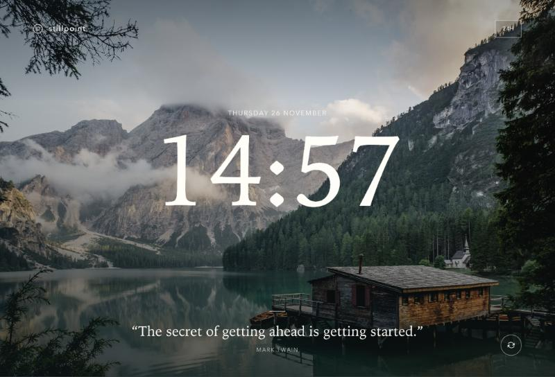

# Stillpoint: Momentum Dash replica

## Purpose
A Chrome extension that replaces the new tab page, inspired by Momentum Dash. Every new tab shows a full-screen landscape photo, a large clock with today's date, and a random inspirational quote. You can switch between 12-hour and 24-hour time and load another quote.

## Data collection
- **Time and date:** read from the computer's clock with JavaScript (`new Date()`), refreshed every second.
- **Quotes:** a fixed list of 12 quotes written directly in `newtab.js`. One is picked at random, never the same one twice in a row.
- **Background photo:** a single photo loaded from Unsplash by its URL (set in `styles.css`). No API or key is used.

## Data persistence
Only one setting is stored: whether you prefer 12-hour or 24-hour time. It is saved in the browser's `localStorage` (key `stillpoint-24-hour`), so the choice is remembered in every new tab. Nothing else is stored, because the clock is live and the quotes are part of the code. No database is needed.

## User interaction
1. Open a new tab in Chrome. Stillpoint appears instead of the default page.
2. Click **24H / 12H** at the top right to switch the time format.
3. Click the circular arrow under the quote to show another quote.

## Setup
No installation, dependencies or configuration needed, only Google Chrome.
1. Download or clone this repository.
2. In Chrome, go to `chrome://extensions`.
3. Turn on **Developer mode** (top right).
4. Click **Load unpacked** and select the `momentum-dash` folder (the one that contains `manifest.json`).
5. Open a new tab.

To remove it, go back to `chrome://extensions` and click **Remove** on Stillpoint.

## Learning
Before this project, I thought browser extensions were something only "real" developers could build. It turns out Stillpoint is just a normal web page (HTML, CSS and a bit of JavaScript) plus one small file, `manifest.json`, where a single line tells Chrome to show my page instead of the usual new tab. That changed how I look at the extensions I use every day. I also learned about `localStorage`: the 12h/24h button remembers your choice in every new tab without any database, which was a good example of storing only what you actually need.

**Challenge:** for me the hard part wasn't the code, it was the organisation. When I sat down to prepare this submission, I honestly didn't remember where the project was. I found it in a separate folder that had a Git repository set up but had never been pushed to GitHub. Moving it into one clean repository with a proper README taught me something I'll keep for the next projects: set up Git and write the README at the start, not at the very end.

## Limitations and assistance
**Limitations**
- Much simpler than the real Momentum: no greeting with your name, weather, to-do list or daily focus.
- Always the same background photo, and it needs an internet connection to load. Offline, a plain dark-green background is shown.
- The quotes are a fixed list of 12; they don't come from an API.

**Assistance**
I built this with Claude (Anthropic's AI assistant). I described what I wanted (a calm new tab with a clock, a photo and quotes) and Claude wrote the code, which I then tested in Chrome. Claude also helped me write this README. The background photo comes from Unsplash; the quotes are well-known public quotes.
