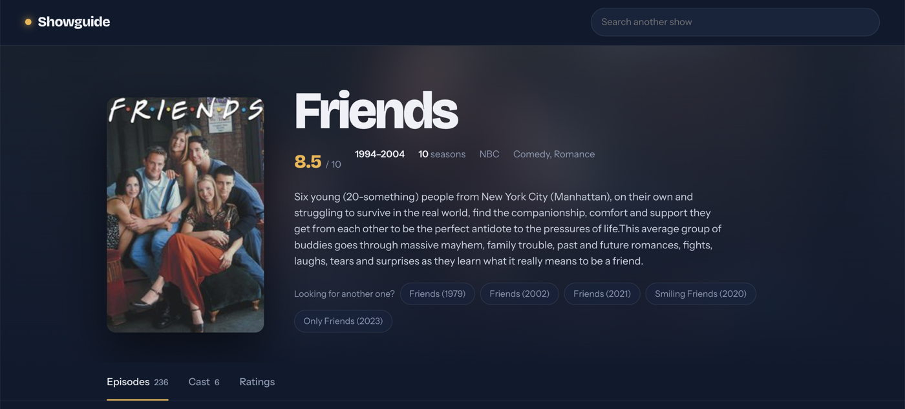

# Showguide: TVmaze API

## Purpose
A one-page web app to explore any TV show. You type a show's name and see its poster, rating and summary, every episode grouped by season, the cast, and a ratings view (a colour grid of every episode plus the top 5 episodes). A panel at the bottom, "How this page gets its data", lists every API call the page made and why.

## Data collection
All data comes live from the free, public [TVmaze API](https://www.tvmaze.com/api). It needs no account or API key. The page uses JavaScript's `fetch()`:

| Step | Endpoint | Why |
|---|---|---|
| 1 | `GET /singlesearch/shows?q=NAME` | Turn the name you typed into the show's ID |
| 2 | `GET /shows/ID/episodes` | Every episode, with season, airdate, summary and rating |
| 3 | `GET /shows/ID/cast` | Actors and the characters they play |
| extra | `GET /search/shows?q=NAME` | Other shows with a similar name ("Looking for another one?") |
| extra | `GET /shows?page=1` | Posters for the decorative background on the start screen |

Steps 2 and 3 run at the same time, since both only need the ID. The ratings grid and top 5 are calculated from the episode list, with no extra call.

## Data persistence
Not applicable. Nothing is saved: every search asks TVmaze again, so the data is always up to date, and there's no account or personal data to keep. The results only live in the page's memory until you search again or close the tab.

## User interaction
1. Open `index.html` in a browser.
2. Type a show (or click a suggestion like *Friends*) and press **Search**.
3. Use the **Episodes**, **Cast** and **Ratings** tabs. In Episodes, pick a season; in Ratings, hover a square to see the episode's title.
4. Search another show from the bar at the top, or click the **Showguide** logo to go back to the start.
5. Open "How this page gets its data" at the bottom to see the API calls.

## Setup
No installation, dependencies or configuration needed.
1. Download or clone this repository.
2. Double-click `tvmaze-api/index.html` to open it in Chrome, Safari or Firefox.

An internet connection is required (for the API, the images and the fonts).

## Learning
What clicked for me with this project is that API calls depend on each other. When you search "Friends", the first call doesn't return any episodes; it only turns the name into an ID. That ID is what unlocks the episodes and the cast. The small log at the bottom of the page, which lists every call and why it was made, is what made this concrete for me, because I could actually watch it happen. Compared with Books to Scrape, I also noticed how much easier structured data is: TVmaze sends clean JSON, so there's nothing to clean up.

**Challenge:** real data is messy even when it comes from an API. Some shows have no poster, no episode ratings or no cast, so the page can't assume the data will always be there. I made each part show a clear message instead of breaking (for example "Fans haven't rated this show's episodes yet"). Searching "Friends" also showed me that a name isn't unique (there's a Friends from 1979 and one from 2021), which is why the page offers the other matches under "Looking for another one?".

## Limitations and assistance
**Limitations**
- No favourites or watch list, because nothing is saved (see Data persistence).
- "Single search" returns TVmaze's best match only; if it picks the wrong show, use the "Looking for another one?" buttons.
- TVmaze has a rate limit (about 20 calls every 10 seconds). Normal use stays far below it, but very fast repeated searches could get an error.
- Some shows have no episode ratings or cast on TVmaze; the page shows a message instead.

**Assistance**
I built this with Claude (Anthropic's AI assistant): I explained what the page should do and Claude wrote the code, which I tested in my browser with different shows. Claude also helped me write this README. The data and images come from the TVmaze API; the fonts are from Google Fonts.
